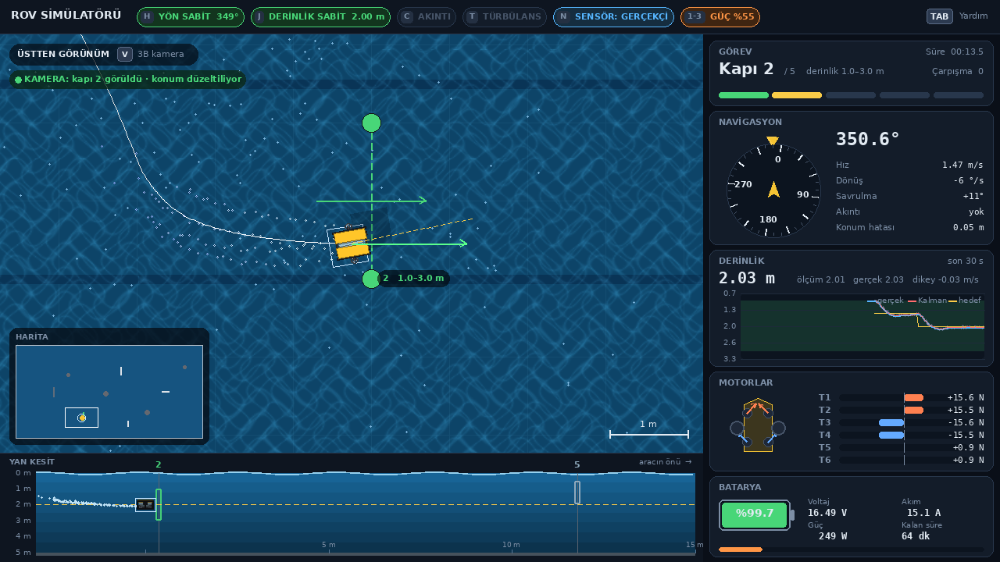
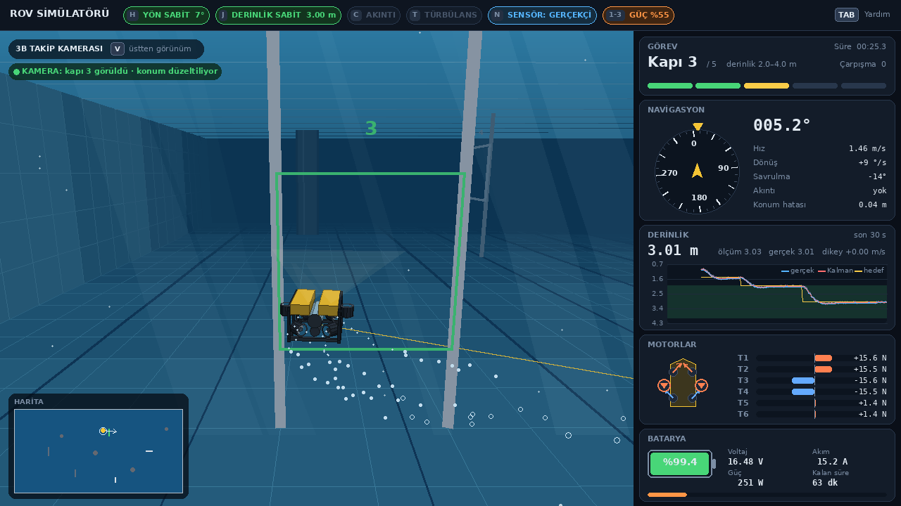

# Su Altı Aracı Fizik Simülatörü 🌊

Python ile yazılmış, klavyeyle sürülebilen ve ekranda canlı çizilen bir ROV (uzaktan kumandalı
su altı aracı) simülatörü. Fiziksel model; **kütle, eklenmiş kütle, hidrodinamik sürtünme, itki ve
akıntı** etkilerini içerir. Gerçek bir araç yazılımındaki katmanlar da modellenmiştir: motor
yerleşimi ve itki dağıtımı, batarya, gürültülü sensörler, kamerayla kapı tespiti, durum kestirimi,
otopilot ve kapılardan kendi kendine geçen **otonom görev**.




## Özellikler

**Fizik**
- 4 serbestlik dereceli **Fossen modeli**: ileri, yanal, dikey ve sapma (yaw) hareketleri
- Eklenmiş kütle, Coriolis / merkezcil terimler (dönüşte savrulma), doğrusal + karesel sürtünme
- Ağırlık ve kaldırma kuvveti (hafif pozitif yüzerlik)
- 4. derece Runge–Kutta (RK4), ekran hızından bağımsız sabit 100 Hz fizik adımı

**Ortam**
- **Türbülanslı akıntı** (Gauss–Markov süreci), derinlikle zayıflar
- 50 × 25 × 5 m **görev havuzu**: 5 kapılı parkur (sıra, yön ve derinlik kuralı), engeller,
  çarpışmalar, süre ve çarpışma sayacı

**Araç donanımı**
- **6 motorlu** BlueROV2 Heavy benzeri yerleşim, sözde ters ile itki dağıtımı, yön koruyan doyum,
  motor gecikmesi
- **Batarya modeli**: pervane teorisine dayalı güç tüketimi, voltaj düşümü, düşük voltajda azalan
  itki, kalan süre tahmini
- **Gürültülü sensörler**: basınç sensörü, pusula, kayan jiroskop, DVL ve **kapı kamerası**

**Araç yazılımı**
- **Durum kestirimi**: derinlik için Kalman filtresi, jiroskop kaymasını öğrenen tamamlayıcı filtre,
  ölü hesapla konum tahmini ve **kamerayla kapı tespitine dayalı konum düzeltmesi**
- **PID otopilot**: baş açısı ve derinlik sabitleme (ileri besleme, koşullu integral)
- **Otonom görev**: rota noktası takibi, bakış hattı yönlendirmesi, kaçırılan kapıda kurtarma davranışı.
  Akıntısız 20/20, türbülanslı akıntıda 10/10 denemede görev tamamlandı.

**Görselleştirme** (harici 3B kütüphanesi olmadan, pygame + numpy)
- Üstten görünüm, **yan kesit şeridi** ve **3B takip kamerası** (V tuşu)
- BlueROV2 Heavy benzeri **3B araç modeli**; pervaneler motor gücüyle döner
- Su efektleri: havuz tabanında ışık desenleri, gölge, motor kabarcıkları, ön ışık konisi,
  yüzeyden süzülen ışık huzmeleri, suda süzülen parçacıklar, bağlantı kablosu
- Gösterge paneli: görev, pusula, canlı derinlik grafiği, motorlar, batarya

**Analiz**
- Uçuş kaydı (CSV) ve 6 panelli uçuş grafikleri
- **24 otomatik doğrulama testi**
- Ayrıntılı **[model dokümanı](docs/MODEL.md)**: denklemler, varsayımlar, parametreler, doğrulama

## Kurulum

Python 3.10 veya üstü gerekir.

```bash
git clone https://github.com/asminnisa7/sualti-simulator.git
cd sualti-simulator
pip install -r requirements.txt
```

## Çalıştırma

```bash
python main.py            # simülatör (klavyeyle sürüş)
python otonom_gorev.py    # otonom görev: araç 5 kapıdan kendi kendine geçer
python grafik.py          # son uçuşun grafikleri
```

| Tuş | İşlev |
|---|---|
| W / S | ileri / geri |
| Q / E | sola / sağa yanal kayma |
| A / D | sola / sağa dönüş |
| R / F | yukarı çıkma / dalma |
| 1 / 2 / 3 | güç %25 / %50 / %100 |
| H | baş açısı sabitleme (otopilot) |
| J | derinlik sabitleme (otopilot) |
| V | görünüm: üstten / 3B takip kamerası |
| N | sensörler: gerçekçi / ideal |
| C | akıntı aç / kapa |
| T | türbülans aç / kapa |
| ← / → | akıntı yönü ∓15° |
| ↑ / ↓ | akıntı hızı ±0.1 m/s |
| + / − veya fare tekerleği | yakınlaştır / uzaklaştır |
| L | uçuş kaydını hemen kaydet |
| Backspace | görevi baştan başlat |
| TAB | yardım penceresi |
| ESC | çıkış (uçuş kaydı otomatik yazılır) |

**Görev:** Kapıları sırayla, ok yönünde ve etiketlerinde yazan derinlik aralığında geç.
Sıradaki kapı, derinliğin doğruysa yeşil, değilse turuncu görünür.

## Otonom görev uçuşu


## Testler ve doğrulama

```bash
python -m pytest -v     # 24 doğrulama testi
python dogrulama.py     # model dokümanındaki grafikleri docs/img/ altına üretir
```

Testler; son hızların analitik çözümle aynı olduğunu, enerjinin kendiliğinden artmadığını,
RK4'ün 4. derece yakınsadığını, motor sınırlarının aşılmadığını, otopilotun gürültülü
sensörlerle hedefe oturduğunu, Kalman filtresinin gürültüyü azalttığını, kamera düzeltmesinin
konum hatasını küçülttüğünü ve otonom görevin tamamlandığını kontrol eder.

## Model

Hareket denklemi (akıntıya göre bağıl hız $\boldsymbol\nu_r$ ile):

$$\mathbf{M}\dot{\boldsymbol\nu}_r + \mathbf{C}(\boldsymbol\nu_r)\boldsymbol\nu_r + \mathbf{D}(\boldsymbol\nu_r)\boldsymbol\nu_r + \mathbf{g} = \boldsymbol\tau$$

Türetme, parametreler ve doğrulama sonuçları için: **[docs/MODEL.md](docs/MODEL.md)**

## Proje yapısı

```
sualti-simulator/
├── main.py             ana döngü ve klavye girişi
├── otonom_gorev.py     otonom görev (rota noktası takibi)
├── ayarlar.py          tüm parametreler
├── fizik.py            hareket denklemleri ve RK4
├── itici.py            motor yerleşimi, itki dağıtımı, doyum, gecikme
├── akinti.py           akıntı ve türbülans
├── batarya.py          güç tüketimi ve batarya
├── sensorler.py        gürültülü sensörler ve kapı kamerası
├── kestirim.py         Kalman filtresi, tamamlayıcı filtre, ölü hesap, kamera düzeltmesi
├── kontrol.py          PID otopilot
├── ortam.py            havuz, kapılar, engeller, çarpışmalar
├── kayit.py            uçuş kaydı
├── grafik.py           uçuş grafikleri
├── dogrulama.py        doğrulama grafikleri
├── test_simulator.py   doğrulama testleri
├── arayuz/
│   ├── sahne.py        üstten görünüm, yan kesit, mini harita
│   ├── kamera3b.py     3B takip kamerası (perspektif izdüşüm, sis)
│   ├── arac_modeli.py  BlueROV2 Heavy benzeri 3B araç modeli
│   ├── efektler.py     kabarcıklar ve ışık desenleri
│   ├── panel.py        gösterge paneli ve durum çubuğu
│   ├── tema.py         renkler ve ortak çizim araçları
│   └── yardim.py       yardım penceresi
└── docs/
    ├── MODEL.md        model dokümanı
    └── img/            grafikler ve ekran görüntüleri
```

## Yazar

Asmin Nisa Karaalp
