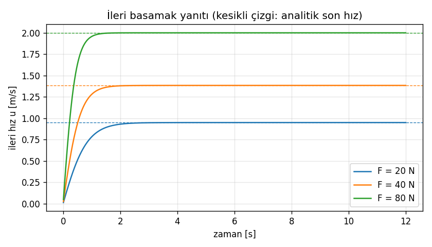
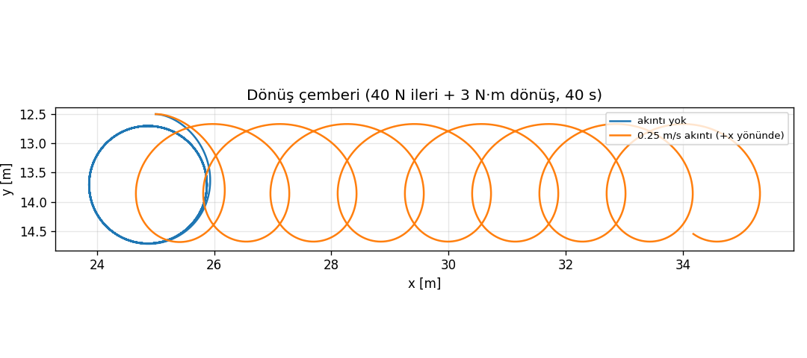
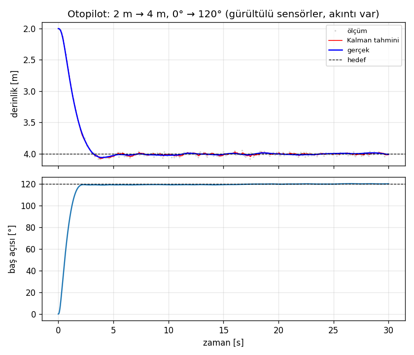
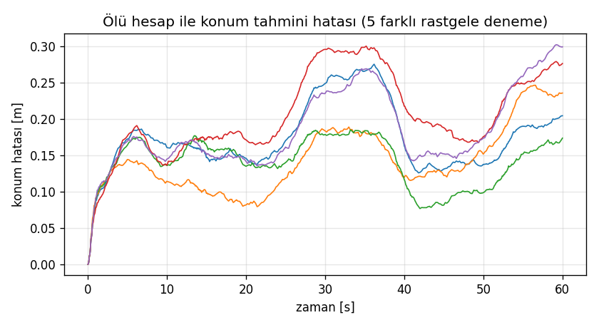
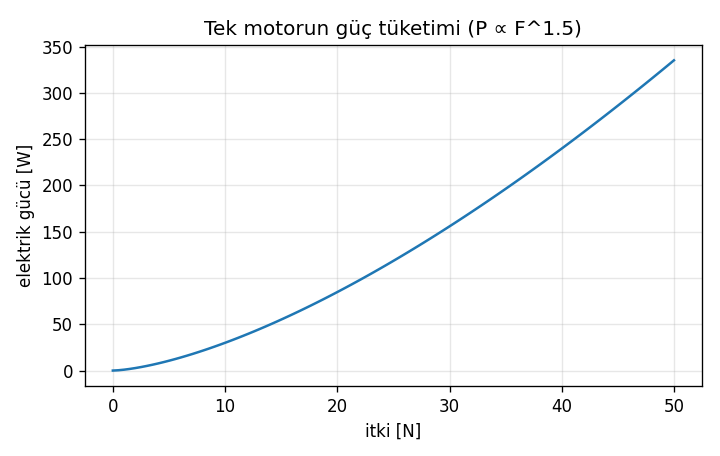
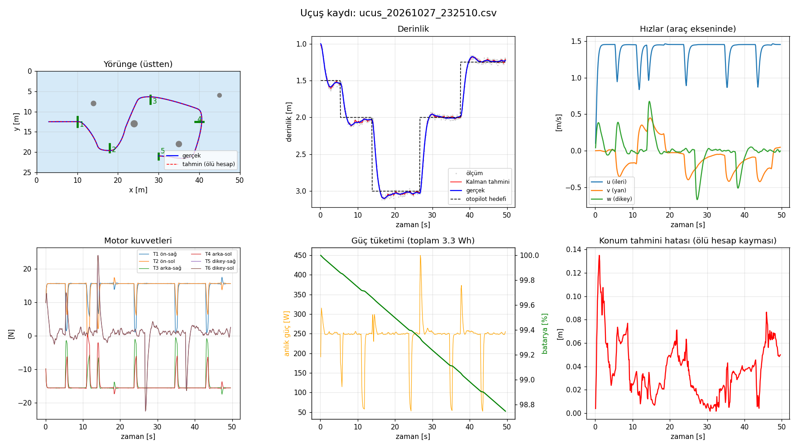

# Model Dokümanı — Su Altı Aracı Fizik Simülatörü

Bu belge simülatördeki fiziksel modeli, motor ve batarya modelini, sensör ve durum kestirimi
yöntemlerini, otopilotu, otonom görevi, sayısal çözüm ve görselleştirme yöntemlerini ve modelin
nasıl doğrulandığını anlatır.
Her bölümde ilgili kodun hangi dosyada olduğu belirtilmiştir.

Grafiklerin tamamı `python dogrulama.py` komutuyla yeniden üretilebilir.

## İçindekiler
1. [Amaç ve kapsam](#1-amaç-ve-kapsam)
2. [Koordinat sistemleri ve durum vektörü](#2-koordinat-sistemleri-ve-durum-vektörü)
3. [Kinematik](#3-kinematik)
4. [Kinetik: hareket denklemi](#4-kinetik-hareket-denklemi)
5. [Akıntı modeli](#5-akıntı-modeli)
6. [Motor (itici) modeli](#6-motor-itici-modeli)
7. [Batarya ve güç modeli](#7-batarya-ve-güç-modeli)
8. [Sensörler ve durum kestirimi](#8-sensörler-ve-durum-kestirimi)
9. [Otopilot (PID)](#9-otopilot-pid)
10. [Otonom görev](#10-otonom-görev)
11. [Görev ortamı](#11-görev-ortamı)
12. [Sayısal çözüm ve yazılım mimarisi](#12-sayısal-çözüm-ve-yazılım-mimarisi)
13. [Görselleştirme](#13-görselleştirme)
14. [Parametreler](#14-parametreler)
15. [Doğrulama](#15-doğrulama)
16. [Varsayımlar ve sınırlamalar](#16-varsayımlar-ve-sınırlamalar)
17. [Geliştirme fikirleri](#17-geliştirme-fikirleri)
18. [Kaynaklar](#18-kaynaklar)

---

## 1. Amaç ve kapsam

Simülatör; **kütle, eklenmiş kütle, hidrodinamik sürtünme, itki ve akıntı** etkilerini içeren,
klavyeyle sürülebilen ve ekranda canlı çizilen bir ROV (uzaktan kumandalı su altı aracı)
modelidir. Fiziksel modelin yanında gerçek bir aracın yazılımında bulunan katmanlar da
modellenmiştir: motor yerleşimi ve itki dağıtımı, batarya, gürültülü sensörler, kamerayla kapı
tespiti, durum kestirimi, otopilot ve kapılardan kendi kendine geçen otonom görev.

Model **4 serbestlik derecelidir (4-DOF)**:

| Serbestlik | Konum | Hız (gövde ekseni) | Kuvvet / moment |
|---|---|---|---|
| İleri (surge) | $x$ | $u$ | $X$ |
| Yanal (sway) | $y$ | $v$ | $Y$ |
| Dikey (heave) | $z$ | $w$ | $Z$ |
| Sapma (yaw) | $\psi$ | $r$ | $N$ |

Yalpa (roll) ve baş-kıç (pitch) modellenmemiştir. ROV'larda ağırlık merkezi kaldırma
merkezinin altında olduğundan bu eksenler kendiliğinden kararlıdır ve küçük kalır (§16).
Model buna rağmen aracın üç boyutlu konumunu ($x, y, z$) ve yönünü verir.

## 2. Koordinat sistemleri ve durum vektörü

- **Dünya ekseni:** $x$ havuz boyunca, $y$ havuz enine, $z$ aşağı doğru (derinlik). Su yüzeyi
  $z = 0$'dır. Eksenler sağ el kuralına uyar (NED kuralına benzer).
- **Gövde ekseni:** Orijin aracın merkezindedir. $x_b$ ileri, $y_b$ sağa, $z_b$ aşağı yönü gösterir.
- **Baş açısı $\psi$:** $\psi = 0$ iken araç $+x$ yönüne bakar. Yukarıdan bakıldığında saat
  yönündeki dönüş pozitiftir.

Durum vektörü (kodda `durum`):

$$
\mathbf{s} = [\,x,\ y,\ z,\ \psi,\ u,\ v,\ w,\ r\,]^T
$$

Konum ve açı dünya ekseninde, hızlar **gövde ekseninde** ve **yere göre** ifade edilir.

## 3. Kinematik

Gövde eksenindeki hızlar, baş açısı kadar döndürülerek dünya eksenine taşınır
(`fizik.py → turev`, adım 1):

$$
\begin{bmatrix}\dot x\\ \dot y\\ \dot z\\ \dot\psi\end{bmatrix}=
\begin{bmatrix}
\cos\psi & -\sin\psi & 0 & 0\\
\sin\psi & \cos\psi & 0 & 0\\
0&0&1&0\\
0&0&0&1
\end{bmatrix}
\begin{bmatrix}u\\ v\\ w\\ r\end{bmatrix}
$$

## 4. Kinetik: hareket denklemi

Fossen'in deniz taşıtları modeli, akıntıya göre **bağıl hız** $\boldsymbol\nu_r = \boldsymbol\nu - \boldsymbol\nu_c$
cinsinden yazılır (`fizik.py → turev`):

$$
\boxed{\ \mathbf{M}\,\dot{\boldsymbol\nu}_r + \mathbf{C}(\boldsymbol\nu_r)\,\boldsymbol\nu_r + \mathbf{D}(\boldsymbol\nu_r)\,\boldsymbol\nu_r + \mathbf{g} = \boldsymbol\tau\ }
$$

Bu denklem Newton'un 2. yasasıdır: *etkin kütle × ivme = motor kuvveti − dönme kaynaklı
terimler − sürtünme − net ağırlık*. Sürtünme ve eklenmiş kütle suya göre harekete bağlı olduğu
için denklemde bağıl hız kullanılır.

### 4.1 Kütle matrisi ve eklenmiş kütle

Su içinde hızlanan bir cisim, çevresindeki suyu da hızlandırmak zorundadır. Bu etki
**eklenmiş kütle** ile modellenir:

$$
\mathbf{M} = \mathbf{M}_{RB} + \mathbf{M}_A = \mathrm{diag}\big(m - X_{\dot u},\ m - Y_{\dot v},\ m - Z_{\dot w},\ I_z - N_{\dot r}\big)
= \mathrm{diag}(17.0,\ 24.2,\ 26.1\ \text{kg},\ 0.28\ \text{kg·m}^2)
$$

Araç simetrik kabul edildiğinden matris köşegendir (`fizik.py → M`). Araç yandan daha geniş
olduğu için yana doğru etkin kütlesi ileriye göre %42 fazladır. Aynı kuvvetle yana daha yavaş
hızlanır (§15'teki test).

### 4.2 Coriolis ve merkezcil terimler

Gövde ekseni araçla birlikte döndüğü için ortaya çıkan terimlerdir (`fizik.py → turev`, adım 3):

$$
\mathbf{C}_{RB}(\boldsymbol\nu_r)\boldsymbol\nu_r = \begin{bmatrix} -m\,v_r\,r \\ m\,u_r\,r \\ 0 \\ 0 \end{bmatrix}
$$

Hızla ilerlerken dönen aracın dönüşün dışına doğru **savrulmasının** sebebi bu terimdir
(Şekil 2'de 34°'lik kayma açısı).

**Eklenmiş kütle Coriolis terimi ($\mathbf{C}_A$) neden yok?** $\mathbf{C}_A$'nın sapma bileşeni
$(X_{\dot u} - Y_{\dot v})\,u\,v$ "Munk momenti"dir. Doğrusallaştırılmış yanal–sapma
dinamiğinin kararlılık koşulu

$$
Y_v\,N_r \;>\; (m - X_{\dot u})\,(X_{\dot u} - Y_{\dot v})\,u_0^2
$$

olup bu parametrelerle $u_0 = 1$ m/s için sol taraf ≈ 0.43, sağ taraf ≈ 122'dir. Yani
potansiyel akış teorisinden gelen Munk momenti modele eklenirse araç birkaç saniye içinde kendi
etrafında dönmeye başlar. Açık çerçeveli ROV'larda akış gövdeden ayrıldığı için bu moment
gerçekte çok daha küçüktür. Düşük hızlı ROV modellerinde $\mathbf{C}_A$ bu nedenle genellikle
ihmal edilir; burada da ihmal edilmiştir.

### 4.3 Hidrodinamik sürtünme (sönüm)

Doğrusal terim düşük hızlarda (yüzey sürtünmesi), karesel terim yüksek hızlarda (form
sürüklemesi) baskındır (`fizik.py → surtunme`):

$$
\mathbf{D}(\boldsymbol\nu_r)\boldsymbol\nu_r =
\begin{bmatrix}
(X_u + X_{u|u|}\,|u_r|)\,u_r\\
(Y_v + Y_{v|v|}\,|v_r|)\,v_r\\
(Z_w + Z_{w|w|}\,|w_r|)\,w_r\\
(N_r + N_{r|r|}\,|r|)\,r
\end{bmatrix}
$$

Karesel terim, klasik sürükleme formülü $F_D = \tfrac12\rho\,C_D\,A\,V|V|$ ile aynı yapıdadır.
Sonuç olarak itkiyi iki katına çıkarmak hızı iki katına çıkarmaz: 40 N'da son hız 1.38 m/s,
80 N'da 2.00 m/s'dir (Şekil 1).

### 4.4 Ağırlık ve kaldırma kuvveti

$W = mg = 112.8$ N, $B = 114.8$ N. Yalpa ve baş-kıç sıfır kabul edildiğinden yalnızca dikey
bileşen kalır:

$$
\mathbf{g} = [\,0,\ 0,\ -(W - B),\ 0\,]^T
$$

Araç bilerek **2 N pozitif yüzer** seçilmiştir. Motorlar durursa yavaşça yüzeye çıkar; gerçek
ROV'larda arıza durumunda aracı kurtarmak için kullanılan bir güvenlik tasarımıdır.

### 4.5 Akıntının gövde eksenindeki değişimi

Kod yere göre hızı ($\boldsymbol\nu$) entegre eder. Akıntı dünyada sabit olsa bile araç döndükçe
gövde eksenindeki görünüşü değişir. Bu değişim de eklenir (`fizik.py → turev`, adım 7):

$$
\dot{\boldsymbol\nu} = \dot{\boldsymbol\nu}_r + \dot{\boldsymbol\nu}_c,\qquad
\dot u_c = r\,v_c,\qquad \dot v_c = -r\,u_c
$$

### 4.6 Sınırlar

Araç su yüzeyinin üstüne ve havuz tabanının altına geçemez; sınıra çarptığında o yöndeki
dikey hızı sıfırlanır (`fizik.py → sinirlari_uygula`). Duvar ve sütun çarpışmaları §11'de
anlatılmıştır.

## 5. Akıntı modeli

Akıntı üç bileşenden oluşur (`akinti.py`):

$$
\mathbf{V}_c(z, t) = \Big(1 - k_z\,\frac{z}{z_{max}}\Big)\Big(\bar V\,[\cos\beta,\ \sin\beta]^T + \boldsymbol\delta(t)\Big)
$$

- **Ortalama akıntı** $\bar V$, yönü $\beta$: kullanıcı ok tuşlarıyla ayarlar.
- **Derinlikle zayıflama:** $k_z = 0.5$; havuz dibinde akıntı yüzeydekinin yarısına düşer.
- **Türbülans $\boldsymbol\delta(t)$:** birinci derece **Gauss–Markov süreci**. Akıntı rastgele
  değişir ama sıçramaz:

$$
\boldsymbol\delta_{k+1} = a\,\boldsymbol\delta_k + \sigma\sqrt{1 - a^2}\;\mathbf{n}_k,\qquad
a = e^{-\Delta t / T},\qquad \mathbf{n}_k \sim \mathcal{N}(0, 1)
$$

$T = 3$ s dalgalanmaların süresini, $\sigma = \max(0.03,\ 0.3\,\bar V)$ şiddetini belirler. Bu
kesikli biçim, sürecin varyansını adım büyüklüğünden bağımsız olarak $\sigma^2$'de tutar.

Havuzda doğal akıntı olmadığı için akıntı varsayılan olarak kapalıdır; kontrolcünün dayanıklılığını
sınamak için açılır.

## 6. Motor (itici) modeli

### 6.1 Yerleşim ve konfigürasyon matrisi

BlueROV2 Heavy benzeri yerleşim kullanılmıştır: 4 yatay motor 45° açıyla ("vectored"),
2 dikey motor. Konumu $(x_i, y_i)$, itki yönü $\alpha_i$ olan yatay motorun katkısı:

$$
X_i = f_i\cos\alpha_i,\qquad Y_i = f_i\sin\alpha_i,\qquad N_i = f_i\,(x_i\sin\alpha_i - y_i\cos\alpha_i)
$$

Tüm motorlar birlikte $\boldsymbol\tau = \mathbf{T}\,\mathbf{f}$ ile yazılır (`itici.py`):

$$
\mathbf{T} =
\begin{bmatrix}
0.707 & 0.707 & -0.707 & -0.707 & 0 & 0\\
-0.707 & 0.707 & -0.707 & 0.707 & 0 & 0\\
0&0&0&0&1&1\\
-0.189 & 0.189 & 0.189 & -0.189 & 0 & 0
\end{bmatrix}
$$

$\mathrm{rank}(\mathbf{T}) = 4$ olduğundan araç dört serbestlik derecesinin hepsinde bağımsız
olarak kontrol edilebilir; yani yengeç gibi yana da kayabilir.

### 6.2 İtki dağıtımı

Pilotun ya da otopilotun istediği $\boldsymbol\tau_d$'yi üretecek motor kuvvetleri,
$\|\mathbf{f}\|^2$'yi (yaklaşık olarak harcanan enerjiyi) en küçük yapan **Moore–Penrose sözde
tersi** ile bulunur:

$$
\mathbf{f} = \mathbf{T}^{+}\,\boldsymbol\tau_d,\qquad \mathbf{T}^{+} = \mathbf{T}^T(\mathbf{T}\mathbf{T}^T)^{-1}
$$

### 6.3 Doyum

Pervaneler geri yönde daha az iter: $f_i \in [-40,\ +50]$ N. Bir motor sınırı aşarsa o gruptaki
(yatay ya da dikey) **tüm motorlar aynı oranda kısılır**. Böylece örneğin "ileri + dönüş"
komutunun yönü korunur, yalnızca büyüklüğü azalır. Sınırlar ayrıca batarya voltajıyla ölçeklenir (§7).

### 6.4 Motor gecikmesi

Motor ve pervane komutu anında üretemez. Birinci derece gecikme modeli kullanılmıştır
($T_m = 0.1$ s). Kesikli hali tam çözümdür ve adım büyüklüğünden bağımsız olarak kararlıdır:

$$
f_i[k+1] = f_i[k] + \big(1 - e^{-\Delta t/T_m}\big)\,\big(f_{i,\text{komut}} - f_i[k]\big)
$$

## 7. Batarya ve güç modeli

### 7.1 Motor gücü

Pervane için momentum (aktüatör disk) teorisine göre $F$ itkisi üretmek için gereken ideal güç
$P = F^{3/2}/\sqrt{2\rho A}$'dır. Motor, sürücü ve pervane kayıpları toplam verim $\eta$ ile
eklenir (`batarya.py → motor_gucu`):

$$
P_i = \frac{|f_i|^{3/2}}{\eta\,\sqrt{2\,\rho\,A}},\qquad A = 0.00454\ \text{m}^2\ (76\ \text{mm pervane}),\quad \eta = 0.35
$$

Bu formül 50 N için **335 W** verir; bu, T200 motorunun 16 V'taki tam güç tüketimine
(~390 W) yakındır. Sonuç olarak itkiyi 2 katına çıkarmak gücü $2^{1.5} \approx 2.8$ katına çıkarır (Şekil 5).

### 7.2 Batarya

4 hücreli lityum batarya (18 Ah, 14.8 V nominal, 266 Wh):

$$
P = P_{\text{elektronik}} + \sum_i P_i,\qquad
V_{oc} = V_{boş} + (V_{dolu} - V_{boş})\cdot\text{SoC},\qquad
V = V_{oc} - I\,R_{iç},\qquad I = P / V
$$

$$
\frac{dE}{dt} = -P
$$

Düşük voltajda motorlar daha az itki üretir: $f_{max}(V) = f_{max,ref}\cdot\min(1,\ V/16\ \text{V})$.
Batarya bitince motorlar durur.

| Durum | Güç | Kalan süre (tam bataryayla) |
|---|---|---|
| Beklemede (sadece elektronik) | 15 W | ~18 saat |
| %50 güçle ileri | ~220 W | ~73 dk |
| %100 güçle ileri | ~590 W | ~27 dk |

## 8. Sensörler ve durum kestirimi

Araç yazılımı (otopilot) gerçek durumu **hiçbir zaman göremez**; yalnızca gürültülü sensör
ölçümlerini görür ve durumu bunlardan tahmin eder. Gerçek bir araçtaki gibi akış şöyledir:
*gerçek durum → sensörler → kestirim → otopilot → motorlar*.

### 8.1 Sensörler (`sensorler.py`)

| Sensör | Ölçtüğü | Sıklık | Gürültü (std) | Sabit hata |
|---|---|---|---|---|
| Basınç sensörü | derinlik $z$ | 10 Hz | 2 cm | — |
| Pusula | baş açısı $\psi$ | 10 Hz | 2° | — |
| Jiroskop | dönüş hızı $r$ | 100 Hz | 0.01 rad/s | 0.005 rad/s (~0.3°/s) |
| DVL (Doppler hız ölçer) | $u$, $v$ | 5 Hz | 1 cm/s | — |
| Kapı kamerası | sıradaki kapının araca göre konumu | 10 Hz | mesafenin %3'ü | — |

**N** tuşu sensörleri ideal (gürültüsüz) yaparak karşılaştırma imkânı verir.

### 8.2 Derinlik: Kalman filtresi (`kestirim.py → DerinlikKalman`)

Durum $\mathbf{x} = [z,\ w]^T$. Tahmin adımında hareket denklemi kullanılır. Yazılım motorlara
ne komut verdiğini bildiği için beklenen ivme hesaplanabilir:

$$
a = \frac{Z_{motor} + W - B - (Z_w + Z_{w|w|}|\hat w|)\,\hat w}{m_{33}},\qquad
\hat{\mathbf{x}}^- = \begin{bmatrix}\hat z + \hat w\,\Delta t + \tfrac12 a\,\Delta t^2\\ \hat w + a\,\Delta t\end{bmatrix}
$$

$$
\mathbf{P}^- = \mathbf{F}\mathbf{P}\mathbf{F}^T + \mathbf{Q},\qquad
\mathbf{F} = \begin{bmatrix}1 & \Delta t\\ 0 & 1\end{bmatrix},\qquad
\mathbf{Q} = \sigma_a^2\begin{bmatrix}\Delta t^4/4 & \Delta t^3/2\\ \Delta t^3/2 & \Delta t^2\end{bmatrix}
$$

Ölçüm geldiğinde ($\mathbf{H} = [1\ \ 0]$, $R = (0.02\ \text{m})^2$):

$$
\mathbf{K} = \frac{\mathbf{P}^-\mathbf{H}^T}{\mathbf{H}\mathbf{P}^-\mathbf{H}^T + R},\qquad
\hat{\mathbf{x}} = \hat{\mathbf{x}}^- + \mathbf{K}\,(z_{ölçüm} - \hat z^-),\qquad
\mathbf{P} = (\mathbf{I} - \mathbf{K}\mathbf{H})\,\mathbf{P}^-
$$

**Sonuç:** Tahmin hatası ham ölçümün yaklaşık yarısıdır (~1 cm'ye karşı 2 cm). Filtre ayrıca
doğrudan ölçülmeyen dikey hızı $\hat w$ da verir; otopilotun türev (D) terimi bunu kullanır.
Geliştirme sırasında ilk sürümde motor kuvveti tahmine dahil edilmemişti. Bu durumda filtre
ham ölçümden **daha kötü** sonuç verdi (~5 cm). Modelin filtreye dahil edilmesinin önemini
gösteren bir sonuçtur.

### 8.3 Baş açısı: tamamlayıcı filtre ve jiroskop kayması

Jiroskop hızlı ve az gürültülüdür ama sabit bir hata (kayma) taşır; tek başına entegre edilirse
açı tahmini sürekli kayar. Pusula kaymaz ama yavaş ve gürültülüdür. Tamamlayıcı filtre ikisini
birleştirir ve kaymayı da öğrenir (Mahony tipi):

$$
\hat\psi \leftarrow \hat\psi + (r_{jiro} - \hat b)\,\Delta t
$$

Her pusula ölçümünde, $e = \mathrm{wrap}(\psi_{pusula} - \hat\psi)$ olmak üzere:

$$
\hat\psi \leftarrow \hat\psi + k_\psi\,e,\qquad \hat b \leftarrow \hat b - k_b\,e
$$

$k_\psi = 0.02$, $k_b = 0.002$. Kayma tahmini olmadan otopilot aracı kalıcı olarak ~1.4°
yanlış yöne tutuyordu ($b / (k_\psi f_{pusula})$). Kayma tahmini eklenince bu hata ortadan
kalktı ve filtre gerçek kaymayı (0.005 rad/s) doğru öğrendi.

### 8.4 Konum: ölü hesap (dead reckoning)

Su altında GPS çalışmaz. Konum, DVL hızının tahmini baş açısıyla döndürülüp zamanla
toplanmasıyla tahmin edilir:

$$
\hat x \leftarrow \hat x + (\cos\hat\psi\,u_{DVL} - \sin\hat\psi\,v_{DVL})\,\Delta t,\qquad
\hat y \leftarrow \hat y + (\sin\hat\psi\,u_{DVL} + \cos\hat\psi\,v_{DVL})\,\Delta t
$$

Ölçüm hataları biriktiği için tahmin zamanla kayar: 60 saniyelik sürüşte ~0.1–0.3 m (Şekil 4),
yani gidilen yolun yaklaşık %1'i. Simülatörde bu tahmin, aracın üstünde çerçeve halinde bir
"hayalet araç" olarak gösterilir.

### 8.5 Kamerayla kapı tespiti ve konum düzeltmesi

Ölü hesabın kayması sınırsız büyüyebilir; bu yüzden gerçek araçlar konumlarını çevredeki bilinen
nesnelere göre düzeltir. Simülatörde kapı kamerası (`sensorler.py → KapiKamerasi`) görüntü
işlemenin sonucunu taklit eder: sıradaki kapı 6 m menzil ve 80° görüş açısı içindeyse, kapı
merkezinin araca göre konumunu ölçer:

$$
\begin{bmatrix} \ell \\ \delta \end{bmatrix} = \mathbf{R}(\psi)^T(\mathbf{g} - \mathbf{p}) + \mathbf{n},\qquad
\mathbf{n}\sim\mathcal{N}(0,\ \sigma^2),\quad \sigma = 0.03\,\|\mathbf{g} - \mathbf{p}\|
$$

Burada $\ell$ ileri, $\delta$ yan uzaklık, $\mathbf{g}$ kapının haritadaki yeridir. Ölçüm, tahmini
konum ve yönle haritaya taşınır; aradaki fark kadar konum tahmini kaydırılır
(`kestirim.py → kapi_ile_duzelt`):

$$
\hat{\mathbf{g}} = \hat{\mathbf{p}} + \mathbf{R}(\hat\psi)\begin{bmatrix} \ell \\ \delta \end{bmatrix},\qquad
\hat{\mathbf{p}} \leftarrow \hat{\mathbf{p}} + k_g\,(\mathbf{g} - \hat{\mathbf{g}}),\qquad k_g = 0.05
$$

Bu, ölü hesaba bir "yer işareti" ile yapılan tamamlayıcı düzeltmedir. 1 m'lik konum hatası,
kapı görüldükten sonra 5 saniyede 10 cm'nin altına iner (§15'teki test). Arayüzde kamera kapıyı
gördüğünde "KAMERA: kapı görüldü" etiketi çıkar ve hayalet aracın gerçek araca yaklaştığı görülür.

## 9. Otopilot (PID)

Gerçek araç yazılımlarındaki (ör. ArduSub) iki temel mod modellenmiştir (`kontrol.py`):

$$
\tau = \tau_{ff} + K_p\,e + K_i\!\int e\,dt - K_d\,\dot y,\qquad e = y_{hedef} - \hat y
$$

- **Baş sabitleme (H):** çıkış tork $N$. Hata $(-\pi, \pi]$ aralığına sarılır, böylece
  350° → 10° geçişinde araç kısa yoldan (20°) döner.
- **Derinlik sabitleme (J):** çıkış dikey kuvvet $Z$. İleri besleme
  $\tau_{ff} = B - W = 2$ N, bilinen net kaldırma kuvvetini baştan dengeler.
- **Türev, ölçümün türevinden** alınır. Hedef aniden değiştiğinde çıkış sıçramaz ("türev tekmesi" olmaz).
- **Koşullu integral:** İntegral yalnızca hata küçükken (0.5 m / 20°) birikir ve çıkışın
  yarısıyla sınırlıdır. Bu, aşmayı ve integral sarılmasını (windup) önler.
- Otopilot **gerçek durumu değil, kestirilen durumu** kullanır (§8).
- Pilot ilgili tuşa basarsa kontrol pilota geçer; tuşu bıraktığı anki değer yeni hedef olur.

**Kazanç seçimi.** Derinlik ekseni yaklaşık olarak
$m_{33}\ddot z + (Z_w + K_d)\dot z + K_p z = 0$ gibi davranır:

| Eksen | $K_p$ | $K_i$ | $K_d$ | Doğal frekans $\omega_n = \sqrt{K_p/m}$ | Sönüm oranı $\zeta = \dfrac{D + K_d}{2\sqrt{K_p\,m}}$ |
|---|---|---|---|---|---|
| Derinlik | 60 | 6 | 40 | 1.5 rad/s | 0.57 |
| Baş açısı | 6 | 0.4 | 1.8 | 4.6 rad/s | 0.72 |

Sonuç (Şekil 3, gürültülü sensörler ve akıntı altında): derinlikte 2 m → 4 m geçişinde aşma
**6 cm**, kalıcı hata **< 1 cm**. Baş açısı 0° → 120° geçişini 2 saniyede tamamlıyor.

## 10. Otonom görev

`otonom_gorev.py`, aracı insan pilot olmadan beş kapıdan geçirir. Teknofest su altı
yarışmalarındaki otonom görevlerin basitleştirilmiş bir karşılığıdır.

- **Rota noktaları:** Her kapı için kapının önünde ve arkasında birer nokta vardır. Araç önce
  kapının önüne gelir, sonra kapının içinden geçer. Sütunların yakınından geçen yerlere ara
  noktalar eklenmiştir.
- **Yön (bakış hattı yönlendirmesi):** Baş sabitleme hedefi, tahmini konumdan sıradaki noktaya olan
  yön açısıdır: $\psi_d = \operatorname{atan2}(y_h - \hat y,\ x_h - \hat x)$.
- **Derinlik:** Derinlik sabitleme hedefi, sıradaki kapının derinlik aralığının ortasıdır.
- **Hız:** Yön hatası 25°'den küçükse %55 ileri itki, değilse %15 (önce dön, sonra ilerle).
- **Kurtarma:** Kapının son noktasına varıldığı halde kapı geçilmemişse araç geri dönüp yeniden dener.
- Araç gerçek konumunu bilmez; kestirilen konumu (§8) kullanır.

**Sonuçlar ve bir tasarım dersi.** İlk sürümde kamera düzeltmesi yoktu. 20 rastgele denemenin
18'inde görev tamamlandı; 2'sinde ölü hesap kayması yüzünden araç kapının tam direk hizasından geçti
ve geçiş sayılmadı. Her yeni denemede kayma büyüdüğü için kurtarma davranışı da sonuç vermedi.
Kamerayla konum düzeltmesi (§8.5) eklendikten sonra:

| Koşul | Başarı | Ortalama süre | Not |
|---|---|---|---|
| Akıntı yok | 20 / 20 | ~50 s | hiç çarpışma ve yeniden deneme yok |
| Türbülanslı akıntı (0.3 m/s) | 10 / 10 | 49–94 s | bazı denemelerde kurtarma davranışı devreye girdi |

## 11. Görev ortamı

`ortam.py`:
- **Havuz:** 50 m × 25 m × 5 m.
- **Kapılar:** 5 kapı. Bir kapı ancak **sırayla**, **ok yönünde**, **iki direğin arasından** ve
  **belirtilen derinlik aralığında** geçilirse sayılır. Geçiş, kapı çizgisine olan işaretli
  uzaklığın negatiften pozitife dönmesiyle algılanır.
- **Engeller:** dibe kadar uzanan silindirik sütunlar.
- **Çarpışma:** Araç duvarın ya da sütunun içine girerse yüzeyin dışına itilir ve hızının yüzeye
  dik bileşeni sıfırlanır. Böylece araç durur ama yüzey boyunca kayabilir. Her yeni temas
  bir çarpışma olarak sayılır.
- Görev süresi ve çarpışma sayısı ekranda gösterilir.

## 12. Sayısal çözüm ve yazılım mimarisi

- **Yöntem:** 4. derece Runge–Kutta (RK4), sabit adım $\Delta t = 0.01$ s (100 Hz)
  (`fizik.py → rk4_adim`). Yerel hata $O(\Delta t^5)$'tir. Adım yarıya indiğinde toplam hata
  ~16 kat azalır; bu testle doğrulanmıştır.
- **Gerçek zaman:** Ekran saniyede 60 kare çizilir. Fizik, bir zaman biriktirici (accumulator)
  ile ekran hızından bağımsız sabit adımlarla ilerler (`main.py`). Bilgisayar yavaşlasa bile
  sonuçlar değişmez.
- **Her fizik adımındaki sıra** (gerçek araç yazılımındaki döngüyle aynı):

  akıntı → sensör ölçümleri → durum kestirimi (+ kamera düzeltmesi) → otopilot → itki dağıtımı →
  motor gecikmesi → batarya → hareket denklemi (RK4) → çarpışmalar → görev → kayıt

| Dosya | Görevi |
|---|---|
| `ayarlar.py` | Tüm parametreler (gerçek araç ölçülünce sadece bu dosya değişir) |
| `fizik.py` | Hareket denklemleri ve RK4 |
| `itici.py` | Motor yerleşimi, itki dağıtımı, doyum, gecikme |
| `akinti.py` | Akıntı ve türbülans |
| `batarya.py` | Güç tüketimi ve batarya |
| `sensorler.py` | Gürültülü sensör modelleri ve kapı kamerası |
| `kestirim.py` | Kalman filtresi, tamamlayıcı filtre, ölü hesap, kamera düzeltmesi |
| `kontrol.py` | PID otopilot |
| `otonom_gorev.py` | Otonom görev (rota noktası takibi) |
| `ortam.py` | Havuz, kapılar, engeller, çarpışmalar |
| `arayuz/` | Görselleştirme (§13): `sahne.py`, `kamera3b.py`, `arac_modeli.py`, `efektler.py`, `panel.py`, `tema.py`, `yardim.py` |
| `kayit.py`, `grafik.py` | Uçuş kaydı (CSV) ve grafikleri |
| `main.py` | Klavye girişi ve ana döngü |
| `test_simulator.py` | 24 doğrulama testi |
| `dogrulama.py` | Bu dokümandaki grafikleri üretir |

## 13. Görselleştirme

Arayüz harici bir 3B kütüphanesi kullanmadan, pygame ve numpy ile yazılmıştır (`arayuz/`).

**Üç görünüm.** Kamera aracı takip eden üstten görünüm, altında havuzu aracın yanından gösteren
yan kesit şeridi ve **V** tuşuyla geçilen 3B takip kamerası. Sağdaki gösterge paneli; görev,
navigasyon (baş-yukarı pusula), derinlik grafiği, motorlar ve batarya kartlarından oluşur.

**3B perspektif izdüşüm** (`kamera3b.py`). Kamera aracın 3 m arkasında ve 1 m yukarısındadır, aracın
yönünü yumuşak bir gecikmeyle izler. Kamera eksenleri ileri $\mathbf{f}$, sağ
$\mathbf{r} = \mathbf{f}\times\mathbf{u}_{dünya}$ ve yukarı $\mathbf{u} = \mathbf{r}\times\mathbf{f}$
vektörleridir. Bir nokta kamera uzayına $\mathbf{c} = [\mathbf{r}\ \mathbf{u}\ \mathbf{f}]^T(\mathbf{p} - \mathbf{p}_{kam})$
ile taşınır ve ekrana perspektif bölmesiyle izdüşürülür:

$$
x_e = c_x + F\,\frac{c_1}{c_3},\qquad y_e = c_y - F\,\frac{c_2}{c_3},\qquad F = \frac{W/2}{\tan(\theta/2)}
$$

- **Yakın düzlem kırpma:** Kameranın arkasına uzanan çizgiler ve çokgenler $c_3 = 0.1$ m düzleminde
  kırpılır (çokgenler için Sutherland–Hodgman).
- **Görünürlük:** Nesneler uzaktan yakına sıralanıp çizilir (ressam algoritması); kapalı cisimlerin
  kameraya dönük olmayan yüzleri çizilmez.
- **Sis:** Su altında görüş mesafesi kısadır. Her rengin uzaklığa göre su rengine karıştırılmasıyla modellenir:
  $\ \mathbf{c}' = \mathbf{c} + (\mathbf{c}_{su} - \mathbf{c})\,(d/d_{sis})^{0.9}$, $d_{sis} = 26$ m.
- **Gölgelendirme:** Her yüz, normali ile ışık yönü arasındaki açıya göre aydınlatılır (düz gölgelendirme):
  $\ k = 0.42 + 0.68\,\max(0,\ -\mathbf{n}\cdot\mathbf{l})$.

**Araç modeli** (`arac_modeli.py`). BlueROV2 Heavy'ye benzeyen, kutu ve silindirlerden kurulmuş
yaklaşık 440 yüzlü bir model: çerçeve plakaları, iki sarı yüzdürme köpüğü, şeffaf elektronik tüpü ve
kamera kubbesi, batarya tüpü, koruyucu halkalı 6 motor, ön ışıklar. Pervaneler motor kuvvetiyle
orantılı hızda döner. Aynı model üç görünümde de kullanılır: 3B'de perspektif, üstten ve yandan dik izdüşümle.

**Su efektleri** (`efektler.py`). Havuz tabanında hareket eden ışık desenleri (kendini tekrar eden bir
sinüs dokusu, iki katman halinde kaydırılıp eklenerek), aracın tabana düşen gölgesi, motorların
itkinin tersine püskürttüğü ve sonra yükselen kabarcıklar, 3B görünümde ön ışık konisi, yüzeyden
süzülen ışık huzmeleri, suda süzülen parçacıklar ve aracın arkasından yüzeye uzanan bağlantı kablosu.

**Performans.** Havuzun sabit geometrisi (yaklaşık 2200 çizgi) bir kez hazırlanır ve her karede numpy
ile toplu dönüştürülür; sisin içinde kaybolan çizgiler çizilmez. Araç modelinin yüz hesapları da
topludur, yazılar önbelleğe alınır. Bu sayede bir karenin hesap yükü 4–6 ms'dir.

## 14. Parametreler

Değerler, BlueROV2 için literatürde yapılmış sistem tanımlama çalışmalarındaki büyüklüklere yakın
seçilmiştir (bkz. Kaynaklar). **Gerçek takım aracının parametreleri ölçüldüğünde yalnızca
`ayarlar.py` değiştirilir.** Kodda katsayılar pozitif büyüklük olarak tutulur ve denklemlerde
işaretle kullanılır.

| Sembol | Değer | Birim | Açıklama |
|---|---|---|---|
| $m$ | 11.5 | kg | kütle |
| $I_z$ | 0.16 | kg·m² | sapma atalet momenti |
| $-X_{\dot u},\ -Y_{\dot v},\ -Z_{\dot w}$ | 5.5, 12.7, 14.57 | kg | eklenmiş kütle |
| $-N_{\dot r}$ | 0.12 | kg·m² | eklenmiş atalet |
| $X_u,\ Y_v,\ Z_w$ | 4.0, 6.2, 5.2 | N·s/m | doğrusal sönüm |
| $N_r$ | 0.07 | N·m·s | doğrusal sapma sönümü |
| $X_{u\|u\|},\ Y_{v\|v\|},\ Z_{w\|w\|}$ | 18.0, 21.7, 37.0 | N·s²/m² | karesel sönüm |
| $N_{r\|r\|}$ | 1.55 | N·m·s² | karesel sapma sönümü |
| $W,\ B$ | 112.8, 114.8 | N | ağırlık, kaldırma kuvveti |
| $f_{max}$ | +50 / −40 | N | motor itki sınırları (16 V) |
| $T_m$ | 0.1 | s | motor zaman sabiti |
| Batarya | 18 Ah, 14.8 V | — | 4S lityum, $R_{iç}$ = 0.02 Ω |
| $\Delta t$ | 0.01 | s | fizik ve kontrol adımı |

## 15. Doğrulama

`test_simulator.py` içindeki **24 test**, modelin analitik olarak bilinen ya da fiziksel olarak
sağlanması zorunlu davranışlarını kontrol eder (`python -m pytest -v`).

| Grup | Test | Doğrulanan |
|---|---|---|
| Fizik | kuvvet yoksa araç kımıldamaz | denge |
| | ileri / dikey son hız | $F = k_1 v + k_2 v^2$ analitik çözümüyle 10⁻³ hassasiyette aynı |
| | eklenmiş kütle | yana hızlanma / ileri hızlanma oranı = kütle oranı |
| | enerji kendiliğinden artmaz | sönüm pasif, model enerji üretmiyor |
| | akıntıya kapılma | itkisiz araç akıntı hızına ulaşır |
| | pozitif yüzerlik | araç yüzeye çıkar, yüzeyi geçmez |
| | RK4 yakınsaması | adım yarıya inince hata ≥ 10 kat azalır |
| Motorlar | saf ileri komut | yan kuvvet ve moment üretmez |
| | doyum | sınırlar aşılmaz, komutun yönü korunur |
| | motor gecikmesi | $t = T_m$'de %63.2 (birinci derece sistem) |
| Kontrol | otopilot | derinlik < 2 cm, açı < 1° hatayla hedefe oturur |
| | gürültülü sensörlerle otopilot | derinlik < 6 cm, açı < 2° |
| | Kalman filtresi | tahmin hatası ölçüm hatasının %70'inden küçük |
| | jiroskop kayması | gerçek kayma doğru öğrenilir |
| | kapı kamerası | 1 m'lik konum hatası 5 s'de 20 cm'nin altına iner |
| Görev | kapı | doğru derinlikte sayılır, yanlış derinlikte sayılmaz |
| | çarpışma | araç duvardan ve sütundan geçemez |
| Batarya / akıntı | motor gücü | $P \propto F^{1.5}$; 50 N'da 300–400 W |
| | batarya biterse | motorlar durur |
| | türbülans | ortalama korunur, dalgalanma var, dipte akıntı zayıf |
| Otonom görev | akıntısız | 5 kapının hepsi çarpışmasız geçilir |
| | türbülanslı akıntıda | görev tamamlanır |

**Şekil 1 — İleri basamak yanıtı.** Simüle edilen hız, her itki değerinde analitik son hıza
(kesikli çizgi) oturur.

**Şekil 2 — Dönüş çemberi.** Akıntısız durumda yarıçapı ~1 m olan kapalı bir çember; araç
dönüşün dışına doğru ~34° savrulur. 0.25 m/s akıntıda yörünge trokoide dönüşür ve 40 saniyede
~10 m sürüklenir (0.25 × 40 = 10 m, beklenen değer).

**Şekil 3 — Otopilot.** Gürültülü sensörler ve akıntı altında derinlik ve baş açısı basamak yanıtı.
Gri noktalar ham derinlik ölçümleri, kırmızı çizgi Kalman tahminidir.

**Şekil 4 — Ölü hesap kayması.** Beş farklı rastgele denemede konum tahmini hatası.

**Şekil 5 — Motor güç eğrisi.**

**Şekil 6 — Otonom görev uçuşu.** `python otonom_gorev.py` ile yapılan görevin kaydı (`grafik.py`):
5 kapı 49.5 saniyede çarpışmasız geçilmiştir. Derinlik grafiğinde otopilotun her kapı için hedef
derinliğe oturduğu, sağ alttaki grafikte de kamera düzeltmesi sayesinde konum hatasının küçük kaldığı görülür.

## 16. Varsayımlar ve sınırlamalar

1. **Yalpa ve baş-kıç ihmal edildi.** Araç bu eksenlerde pasif kararlı kabul edildi; dikey
   motorların oluşturduğu yalpa momenti hesaba katılmadı.
2. **Köşegen kütle ve sönüm matrisleri.** Eksenler arası hidrodinamik bağlaşım (ör. $Y_r$, $N_v$)
   ve $\mathbf{C}_A$ (Munk momenti, §4.2) ihmal edildi.
3. **Akıntı** yatay düzlemde ve uzayda düzgündür (sadece derinlikle değişir). Dalga ve dikey akıntı yoktur.
4. **Motor modeli:** Kuvvet doğrudan komut edilir; pervane devri–itki eğrisi ve motorlar arası
   akış etkileşimi modellenmedi.
5. **Parametreler** literatürdeki BlueROV2 değerlerine yakındır; takımın kendi aracı için
   ölçülmesi (sistem tanımlama) gerekir.
6. **Ölü hesapta** DVL ölçümü bir sonraki ölçüme kadar sabit tutulur; hızlanma anlarında bu, kısa
   süreli ek konum hatası oluşturur (Şekil 4'teki ilk saniyeler).
7. **Kapı kamerası** görüntü işlemenin sonucunu taklit eder: kapı görüş alanındaysa her zaman algılanır,
   yanlış algılama ve engellerin kapıyı örtmesi modellenmedi.
8. **Otonom görevin rotası** elle tanımlıdır; otomatik yol planlaması yoktur.
9. **Bağlantı kablosu (tether)** yalnızca görseldir; sürüklemesi ve tabanla temas kuvvetleri modellenmedi.

## 17. Geliştirme fikirleri

- 6 serbestlik dereceli modele geçiş (yalpa ve baş-kıç, metasantrik yükseklik)
- Konum için genişletilmiş Kalman filtresi (EKF); akustik konumlandırma (USBL) ölçümleri
- Otonom görev için otomatik yol planlama (ör. A*) ve engelden kaçınma
- Sanal kamera görüntüsü üretip gerçek görüntü işleme (OpenCV) ile kapı tespiti
- ROS 2 arayüzü: simülatörün gerçek araç yazılımıyla aynı mesajları kullanması
- Gerçek araçtan alınan verilerle parametre tanımlama

## 18. Kaynaklar

- T. I. Fossen, *Handbook of Marine Craft Hydrodynamics and Motion Control*, 2. baskı, Wiley, 2021.
- SNAME, *Nomenclature for Treating the Motion of a Submerged Body Through a Fluid*, 1950.
- C.-J. Wu, *6-DoF Modelling and Control of a Remotely Operated Vehicle*, yüksek lisans tezi,
  Flinders University, 2018 (BlueROV2 parametre tanımlaması).
- R. E. Kalman, "A New Approach to Linear Filtering and Prediction Problems",
  *Journal of Basic Engineering*, 1960.
- R. Mahony, T. Hamel, J.-M. Pflimlin, "Nonlinear Complementary Filters on the Special Orthogonal
  Group", *IEEE Transactions on Automatic Control*, 2008.
- Blue Robotics, BlueROV2 ve T200 motor teknik belgeleri.
